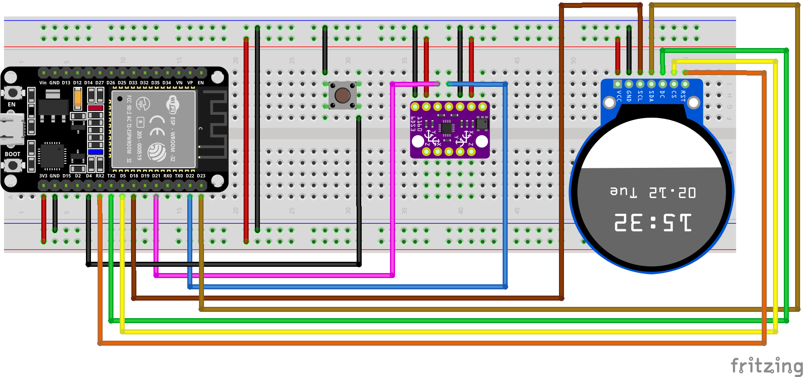

# Electronic-crosshair-spirit-level
This project is about building an electronic crosshair spirit level. This is nothing new or extraordinary
but in this combination useful as an helper for drilling holes in the desired orientation.

In the following parts the components and the wiring is described, so that even a non-skilled maker can setup
a simple electronic crosshair spirit level on her or his own.

## Bill of material for the POC
In principle a huge number of components can be used to realize this project. The list below is one
possible combination for a proof-of-concept (POC) version.

 - Bosch BMI160 6-DOF inerita measurement unit (IMU) breakout board (approx. 5 to 8 €).
 - 1.28" round TFT screen (240x240 pixel) with GC9A01A controller (approx. 5 to 10 €).
 - ESP32 development board. Many options are here possible. For POC every ESP32 will work. For practical
   realization an ESP32-C3 supermini including 1 cell Li-Ion-battery charging connector will be optimal. (approx. 5 €)
 - Standard breadboard.
 - Push button (tactile switch for the tare function) with 2 connections (4 will work also, but only 2 are used).
 - Jumper wires.

## Wiring
The display and the sensor get their power from the ESP32 3.3V connector. For the POC the ESP32 can be powered by USB/5V.

The Fritzing diagram explains one possible setup with an ESP32 Dev board with 30 PINs.

Thanks to the great Fritzing and the team behind it.
